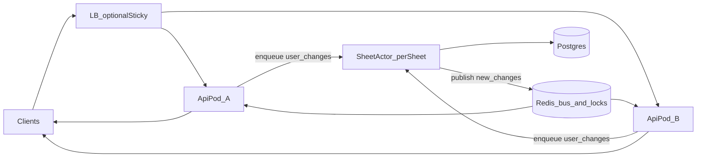

# 千人同表规模方案（下一主线）

> 状态：**进行中（2026-10-28）— S1–S5 代码已落地；§4 千连接压测基线待跑**  
> 前置：私有化量产协同已收口（见 [COLLAB.md](./COLLAB.md) §9）  
> 不做：企微登录/通讯录/真群、像素级 UI、新功能盘

## 0. 为什么要做

当前 `/collab` 适合**私有化常规并发**（多表分摊、单表数十人级）：

| 能力 | 现状 | 千人同表时的问题 |
|------|------|------------------|
| 房间扇出 | 单 API 进程内 `broadcast` | 上千连接时 CPU/带宽打爆；非 sticky 副本收不到 |
| 写合入 | 多客户端抢 `sheet_rev` + OT | 热点表版本冲突风暴、DB 争用、accept 延迟抖动 |
| 部署 | sticky `/collab`+`/live` + Redis 锁 | sticky 单点房容量仍受单机连接数限制 |

目标：同一张表 **~1000 在线连接** 仍可编辑、锁正确、变更可感知（允许光标/presence 降采样）。

## 1. 目标与非目标

**目标**

1. **每表 Actor 串行合入**：同一 `sheetId` 的 `user_changes` / HTTP `commitchanges` 进单写者队列，顺序 bump `sheet_rev`、落 changeset、再扇出。
2. **跨副本扇出**：accept 后的 `new_changes` / 锁更新 / presence 经 Redis（或等价总线）到达所有持有该房连接的 API 副本；可逐步弱化对 sticky 的硬依赖（过渡期仍建议 sticky）。
3. **连接与热点可观测**：每表连接数、队列深度、accept 延迟、冲突率进 `/metrics`；压测门槛可复现。

**非目标（本阶段）**

- 像素级企微 WS/Engine.IO 兼容
- 跨表全局单一 Actor
- 光标/presence 的强一致（可节流、可丢中间态）

## 2. 架构（目标态）



- **SheetActor**：逻辑单写者（可用 BullMQ 按 `sheetId` 分区、或进程内 queue + Redis 分布式锁选主）。同一 sheet 同时只有一个执行者跑 commit。
- **Fanout bus**：`collab:sheet:{id}` 频道；payload 与现有 `CollabServerMsg` 对齐（`new_changes` / `cell_lock_update` / `user_newinfos` 等）。
- **CellLock**：已 Redis 化，保持；Actor 不替代人手短租约。

## 3. 切片顺序（实施时按此推进）

| 切片 | 内容 | 状态 | 验收 |
|------|------|------|------|
| S1 | 文档 + metrics：每表连接数、accept p95、冲突计数 | **已落地** | `GET /metrics`：`collab_connections` / `collab_sheet_connections` / `collab_accept_duration_ms_p95` / `collab_conflict_total` / `collab_sheet_queue_depth` |
| S2 | 单进程内 per-sheet 串行队列（Actor 雏形） | **已落地** | `SheetCommitQueue` 包裹 HTTP/WS `commit`；同表同进程串行；跨副本仍靠 advisory lock |
| S3 | Redis pub/sub 扇出 `new_changes`（跨副本） | **已落地** | `CollabFanoutService` 频道 `collab:sheet:{id}`；`COLLAB_REDIS=0` 可关；锁/comm_notice/new_changes 随 `broadcast` 扇出 |
| S4 | Actor 外置/分布式（按 sheet 分区消费） | **已落地** | `COLLAB_SHEET_ACTOR=bullmq` 启用；`sheet-commits` 队列 + worker 内 Redis 锁 `st:sheet-actor:{sheetId}`；默认 `memory` 不变 |
| S5 | presence/cursor 降采样 + 连接上限/背压 | **已落地** | `COLLAB_MAX_SHEET_CONNECTIONS`（默认 1000）拒连 `ROOM_FULL`；光标 coalesce + 仅本机扇出；presence 防抖；指标 `collab_connection_rejected_total` / `collab_cursor_*` |

## 4. 压测门槛（收工）

- 单表 **1000** WebSocket 连接（可多机压测客户端）。
- 持续写入：≥ **50 commits/s** 量级（可调），accept p95 有基线且文档记录。
- 双副本：关闭 sticky 时，对端仍能收到 `new_changes`（S3+）。
- 回归：`collab-realtime`、`offline-sync`、grid 相关 Playwright 全绿；锁拒绝仍正确。

### 4.1 复现命令

```bash
# API :3000 已起；默认 100 连接冒烟
pnpm perf:collab

# 门槛级（需机器资源；结果写入 artifacts/perf/collab-scale.json）
PERF_COLLAB_CONNECTIONS=1000 PERF_COLLAB_WRITERS=20 PERF_COLLAB_DURATION_S=30 \
  PERF_COLLAB_TARGET_CPS=50 pnpm perf:collab
```

### 4.2 基线记录

| 日期 | 连接 | commits/s | accept p95 | 环境 | 备注 |
|------|------|-----------|------------|------|------|
| （待跑） | 1000 | ≥50 | 填入 | | 跑通后改本表；未填数字前勿宣称达标 |

## 5. 代码锚点

- 房与广播：[`apps/api/src/collab/collab-room.service.ts`](../apps/api/src/collab/collab-room.service.ts)
- 跨副本扇出：[`apps/api/src/collab/collab-fanout.service.ts`](../apps/api/src/collab/collab-fanout.service.ts)
- 提交 + Actor 队列：[`apps/api/src/sheets/commit-changes.service.ts`](../apps/api/src/sheets/commit-changes.service.ts)、[`sheet-commit-queue.service.ts`](../apps/api/src/sheets/sheet-commit-queue.service.ts)
- 锁：[`apps/api/src/collab/cell-lock.registry.ts`](../apps/api/src/collab/cell-lock.registry.ts)
- Metrics：[`apps/api/src/metrics/metrics.service.ts`](../apps/api/src/metrics/metrics.service.ts)
- Live 总线可参考：[`apps/api/src/live/live-bus.service.ts`](../apps/api/src/live/live-bus.service.ts)（Redis pub/sub 模式）
- 部署约束：[`docs/DEPLOYMENT.md`](./DEPLOYMENT.md) §6

## 6. 与交付边界

- **已交付**：私有化量产协同；千人同表 **S1–S5**（压测脚本/基线数字仍待写入 §4）。
- **仍缺**：§4 千连接压测可复现报告（勿在无数字时宣称达标）。
- 跟踪入口：[`docs/REMAINING-GAPS.md`](./REMAINING-GAPS.md) §0。
