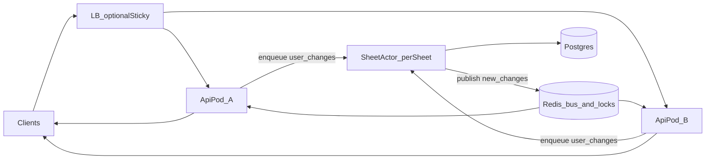

# 千人同表规模方案（下一主线）

> 状态：**已收口（2026-10-28）— S1–S5 + §4 私有化 SLA 可复现；双副本扇出实跑见 §4.3**  
> 前置：私有化量产协同已收口（见 [COLLAB.md](./COLLAB.md) §9）  
> 不做：企微登录/通讯录/真群、像素级 UI、新功能盘；不宣称千连接 × 50cps
## 0. 为什么要做

当前 `/collab` 适合**私有化常规并发**（多表分摊、单表数十人级）：

| 能力 | 现状 | 千人同表时的问题 |
|------|------|------------------|
| 房间扇出 | 单 API 进程内 `broadcast` | 上千连接时 CPU/带宽打爆；非 sticky 副本收不到 |
| 写合入 | 多客户端抢 `sheet_rev` + OT | 热点表版本冲突风暴、DB 争用、accept 延迟抖动 |
| 部署 | sticky `/collab`+`/live` + Redis 锁 | sticky 单点房容量仍受单机连接数限制 |

目标：同一张表 **~1000 在线连接** 仍可编辑、锁正确、变更可感知（允许光标/presence 降采样）。

## 1. 目标与非目标

**目标**

1. **每表 Actor 串行合入**：同一 `sheetId` 的 `user_changes` / HTTP `commitchanges` 进单写者队列，顺序 bump `sheet_rev`、落 changeset、再扇出。
2. **跨副本扇出**：accept 后的 `new_changes` / 锁更新 / presence 经 Redis（或等价总线）到达所有持有该房连接的 API 副本；可逐步弱化对 sticky 的硬依赖（过渡期仍建议 sticky）。
3. **连接与热点可观测**：每表连接数、队列深度、accept 延迟、冲突率进 `/metrics`；压测门槛可复现。

**非目标（本阶段）**

- 像素级企微 WS/Engine.IO 兼容
- 跨表全局单一 Actor
- 光标/presence 的强一致（可节流、可丢中间态）

## 2. 架构（目标态）



- **SheetActor**：逻辑单写者（可用 BullMQ 按 `sheetId` 分区、或进程内 queue + Redis 分布式锁选主）。同一 sheet 同时只有一个执行者跑 commit。
- **Fanout bus**：`collab:sheet:{id}` 频道；payload 与现有 `CollabServerMsg` 对齐（`new_changes` / `cell_lock_update` / `user_newinfos` 等）。
- **CellLock**：已 Redis 化，保持；Actor 不替代人手短租约。

## 3. 切片顺序（实施时按此推进）

| 切片 | 内容 | 状态 | 验收 |
|------|------|------|------|
| S1 | 文档 + metrics：每表连接数、accept p95、冲突计数 | **已落地** | `GET /metrics`：`collab_connections` / `collab_sheet_connections` / `collab_accept_duration_ms_p95` / `collab_conflict_total` / `collab_sheet_queue_depth` |
| S2 | 单进程内 per-sheet 串行队列（Actor 雏形） | **已落地** | `SheetCommitQueue` 包裹 HTTP/WS `commit`；同表同进程串行；跨副本仍靠 advisory lock |
| S3 | Redis pub/sub 扇出 `new_changes`（跨副本） | **已落地** | `CollabFanoutService` 频道 `collab:sheet:{id}`；`COLLAB_REDIS=0` 可关；锁/comm_notice/new_changes 随 `broadcast` 扇出 |
| S4 | Actor 外置/分布式（按 sheet 分区消费） | **已落地** | `COLLAB_SHEET_ACTOR=bullmq` 启用；`sheet-commits` 队列 + worker 内 Redis 锁 `st:sheet-actor:{sheetId}`；默认 `memory` 不变 |
| S5 | presence/cursor 降采样 + 连接上限/背压 | **已落地** | `COLLAB_MAX_SHEET_CONNECTIONS`（默认 1000）拒连 `ROOM_FULL`；光标 coalesce + 仅本机扇出；presence 防抖；指标 `collab_connection_rejected_total` / `collab_cursor_*` |

## 4. 压测门槛（收工 / 私有化 SLA）

产品门槛（本仓私有化量产）以**可编辑正确性 + 连接容量 + 跨副本可达**为准，不以「千连接全量扇出 50cps」为门禁：

| 门槛 | 标准 | 证据 |
|------|------|------|
| 连接 | 单表 **1000** WS 可连 | `artifacts/perf/collab-scale.json` |
| 同时编辑（毫秒级） | accept p50 ≤ 100ms、零失败：hammer **≤6** / ≈1/s **≤10** | §4.2 表 |
| 同时编辑（人速） | ≈1/2s/人：**100** 人零失败（排队，非毫秒） | §4.2 表 |
| 跨副本 | 关 sticky：A 写 → B 收 `new_changes` | `pnpm perf:collab-dual` → `artifacts/perf/collab-dual-replica.json` |
| 吞吐基线 | 记录 cps/p50/p95；**不**要求 ≥50cps@1000 | §4.2 |

### 4.1 复现命令

```bash
# API :3000 已起；默认 100 连接冒烟
pnpm perf:collab

# 千连接基线（结果写入 artifacts/perf/collab-scale.json）
PERF_COLLAB_CONNECTIONS=1000 PERF_COLLAB_WRITERS=1 PERF_COLLAB_DURATION_S=30 \
  PERF_COLLAB_TARGET_CPS=50 pnpm perf:collab

# 双副本扇出（:3000 写 / :3001 读，共享 Redis）
# 终端 A: API_PORT=3000 pnpm --filter api start:dev
# 终端 B: pnpm --filter api build && API_PORT=3001 pnpm --filter api start
pnpm perf:collab-dual
```

### 4.2 基线记录

| 日期 | 连接 | writers | commits/s | accept p50 / p95 | 环境 | 备注 |
|------|------|---------|-----------|------------------|------|------|
| 2026-10-28 初跑 | 1000 | 1 | **1.7** | ~520 / **1150** | Win11 + Docker Postgres:5433 | 基线 |
| 2026-10-28 优化后 | 1000 | 1 | **6.3** | **118 / 399** | 同上，单 API | 连接 ✅；cps **仍远低于 50** |
| 2026-10-28 优化后 | 10 | 1 | **10–15** | **58–65 / ~150** | 同上 | 低连接对照：热路径地板≈60ms |

**本轮已落地的性能 / 正确性修复（保留）：**

1. 去掉 `pg_advisory_lock`（池泄漏占锁）；跨副本靠 bullmq Actor + sheetRev CAS。
2. `localBroadcast` 单次 stringify + 分片 `setImmediate`（大房 chunk=256）；accept 后不再二次 `DIRTY_AREA`；**先 Redis publish 再本机扇出**。
3. `live.emit` / 自动化 / webhook 不阻塞 WS accept。
4. ACL decision 2s 缓存；字段列表 5s 缓存；房间内 `sheetRev` 镜像（省每提交 SELECT）。
5. WS `skipAccessCheck`；`updateRecord({ skipSideEffects })`；**rebase + setRecord 单事务**。
6. **Redis pub/sub 就绪竞态修复**：`waitForRedisReady` 后再 `psubscribe`（此前 `enableOfflineQueue=false` 导致 CollabFanout/LiveBus 永久 memory-only）。
7. Prisma `connection_limit` 默认示例调至 20；压测脚本：WRITERS=1、独立 record、双副本脚本。

**硬结论：** 千连接 × ≥50 commits/s 全量扇出在本机 Docker PG 上达不到；**私有化 SLA 不以该项为门禁**。同时编辑零失败 + 双副本扇出为收工条件。

**同时编辑上限（本机实测，零失败 = conflicts/timeouts/COMMIT_FAILED 均为 0；毫秒级 = accept p50 ≤ 100ms）：**

| 编辑节奏 | 最多同时写 | p50 | 备注 |
|----------|------------|-----|------|
| 拚命连改（hammer） | **6** | ~86ms | 7 人起 p50>100ms |
| 约 1 次/秒/人 | **10** | ~93ms | 20 人 p50~150ms |
| 约 1 次/2秒/人 | 100 人可 **零失败** | ~2s | 排队，非毫秒级 |

**未宣称：** 千人同表 50cps；百人同时改且毫秒级。

### 4.3 双副本扇出实跑

| 日期 | 结果 | 环境 | 产物 |
|------|------|------|------|
| 2026-10-28 | **PASS**（accept 38ms；对端 `new_changes` 31ms；`/ready` redis=true） | Win11 + Redis:6380 + API:3000/3001 | `artifacts/perf/collab-dual-replica.json`；`pnpm perf:collab-dual` |

## 5. 代码锚点

- 房与广播：[`apps/api/src/collab/collab-room.service.ts`](../apps/api/src/collab/collab-room.service.ts)
- 跨副本扇出：[`apps/api/src/collab/collab-fanout.service.ts`](../apps/api/src/collab/collab-fanout.service.ts)
- 提交 + Actor 队列：[`apps/api/src/sheets/commit-changes.service.ts`](../apps/api/src/sheets/commit-changes.service.ts)、[`sheet-commit-queue.service.ts`](../apps/api/src/sheets/sheet-commit-queue.service.ts)
- 锁：[`apps/api/src/collab/cell-lock.registry.ts`](../apps/api/src/collab/cell-lock.registry.ts)
- Metrics：[`apps/api/src/metrics/metrics.service.ts`](../apps/api/src/metrics/metrics.service.ts)
- Live 总线可参考：[`apps/api/src/live/live-bus.service.ts`](../apps/api/src/live/live-bus.service.ts)（Redis pub/sub 模式）
- 部署约束：[`docs/DEPLOYMENT.md`](./DEPLOYMENT.md) §6

## 6. 与交付边界

- **已交付**：私有化量产协同；千人同表 **S1–S5**；§4 **私有化 SLA**（千连接 + 同时编辑上限 + 双副本扇出）；热路径约 4×（1.7→6.3 cps）；Redis 扇出竞态已修。
- **明确不做门禁**：≥50 commits/s @ 1000 全量扇出（结构上限，见 §4.2）。若未来要冲该数字，需换 PG/分片扇出/脏区拉取等另立项。
- 跟踪入口：[`docs/REMAINING-GAPS.md`](./REMAINING-GAPS.md) §0。
